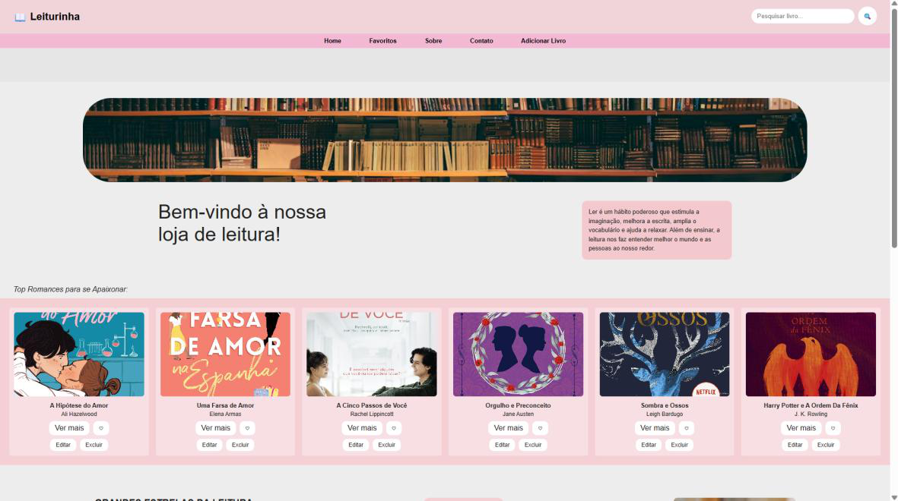

# 📖 Leiturinha — Sistema Web de Gerenciamento de Livros

Aplicação web acadêmica desenvolvida em equipe para a disciplina de **Desenvolvimento Web** do curso de Engenharia de Software da **Universidade Veiga de Almeida (UVA)**.

O Leiturinha reúne um catálogo de livros e permite consultar obras, buscar por título, adicionar favoritos e gerenciar cadastros com operações **CRUD**. O projeto utiliza PHP e MySQL no backend e HTML, CSS e JavaScript no frontend.

> **Projeto acadêmico/demonstrativo:** esta versão não possui autenticação administrativa ou controles completos de segurança para uso público em produção. Não a utilize com dados reais sem implementar essas proteções.

## Demonstração visual



Outras telas do trabalho: [Cadastro](docs/screenshots/cadastro.png) · [Favoritos](docs/screenshots/favoritos.png) · [Contato](docs/screenshots/contato.png).

## Funcionalidades implementadas

- **Catálogo:** listagem de livros cadastrados, com título e autor.
- **Pesquisa:** filtro de livros por título na página inicial.
- **Detalhes:** informações de cada livro, incluindo sinopse e editora.
- **CRUD:** cadastro, consulta, edição e exclusão de livros pelo navegador.
- **Favoritos:** registro de livros favoritos no banco MySQL.
- **Contato:** formulário para gravar mensagens no banco de dados.
- **Layout:** páginas com HTML e CSS e interações em JavaScript.

### Tecnologias

- PHP com PDO para acesso ao banco de dados;
- MySQL/MariaDB e SQL;
- HTML5, CSS3 e JavaScript;
- Ambiente local com PHP e MySQL, ou hospedagem PHP/MySQL compatível (ex.: InfinityFree).

## Estrutura do repositório

```text
Site-Leiturinha/
├── assets/
│   ├── css/style.css            # Estilos compartilhados
│   └── js/script.js             # Busca e comportamentos de interface
├── config/
│   ├── database.php             # Conexão PDO sem credenciais
│   ├── database.example.php     # Modelo de configuração local
│   └── .htaccess                # Bloqueio de acesso HTTP à pasta config (Apache)
├── database/
│   └── leiturinha.sql           # Estrutura e dados demonstrativos do banco
├── docs/
│   └── screenshots/            # Capturas de tela da versão apresentada
├── legacy/
│   ├── index.html              # Protótipo estático antigo
│   ├── produto1.html ...       # Páginas demonstrativas antigas
│   └── login.html              # Tela estática, sem login funcional
├── index.php                   # Página inicial dinâmica
├── produto.php                 # Detalhes de um livro
├── create.php                  # Cadastrar livro
├── edit.php                    # Editar livro
├── delete.php                  # Excluir livro
├── favorito.php                # Registrar favorito
├── favoritos.php               # Listar favoritos salvos no MySQL
├── contato.html                # Formulário de contato
├── contato.php                 # Processar e salvar mensagem
├── .gitignore
└── README.md
```

> As páginas funcionais principais continuam na **raiz** para preservar os endereços da aplicação. Arquivos antigos de demonstração foram guardados em `legacy/` para não concorrerem com `index.php`.

## Como executar localmente

### Requisitos

- PHP **8.x** (com extensões `pdo_mysql` e `mbstring`);
- MySQL 8+ ou MariaDB compatível;
- Navegador web.

### 1. Obtenha o código

```bash
git clone https://github.com/adolfo-araujo/Site-Leiturinha.git
cd Site-Leiturinha
```

### 2. Crie e configure o banco

Crie um banco de dados chamado `leiturinha` no MySQL/MariaDB e importe o script `database/leiturinha.sql` (via phpMyAdmin ou terminal):

```bash
mysql -u root -p leiturinha < database/leiturinha.sql
```

**Atenção:** o arquivo SQL contém comandos `DROP TABLE IF EXISTS`. Use apenas em um banco novo/de testes — a importação apaga tabelas com os mesmos nomes.

### 3. Configure a conexão sem publicar senhas

Faça uma cópia de `config/database.example.php` com o nome `config/database.local.php` e altere `host`, `name`, `user` e `password` conforme o seu MySQL. **Não envie `database.local.php` ao GitHub**: ele está bloqueado pelo `.gitignore`.

Como alternativa, defina `DB_HOST`, `DB_NAME`, `DB_USER` e `DB_PASSWORD` como variáveis de ambiente.

### 4. Inicie o servidor local

```bash
php -S localhost:8000
```

Abra <http://localhost:8000/index.php>.

Se utilizar XAMPP/WAMP, copie a pasta do projeto para o diretório público do servidor, configure o banco e acesse `index.php` na URL local correspondente.

## Hospedagem (InfinityFree)

1. Crie o banco de dados pelo painel da hospedagem.
2. Importe `database/leiturinha.sql` no phpMyAdmin do banco **de testes**.
3. Envie os arquivos do projeto para o diretório público da hospedagem, **mantendo a estrutura de pastas**.
4. No servidor, crie `config/database.local.php` a partir de `config/database.example.php` e informe as credenciais fornecidas pela hospedagem. Não coloque esse arquivo no GitHub.
5. Abra a URL da instalação e confira catálogo, detalhes, CRUD, favoritos e contato.

> Se uma senha de produção já foi commitada ou compartilhada, **troque essa senha**. Colocar o arquivo no `.gitignore` ou apagá-lo da versão atual **não apaga** o segredo do histórico de commits.

## Banco de dados

| Tabela | Finalidade |
|---|---|
| `autor` | Autores cadastrados |
| `livro` | Livros; `id_autor` referencia `autor` |
| `favorito` | Livros favoritados; `id_livro` referencia `livro` |
| `contato` | Mensagens enviadas pelo formulário |

O script inclui registros demonstrativos para facilitar o teste inicial.

## Limitações conhecidas e próximos passos

- Adicionar login, perfis e autorização antes de permitir operações administrativas em um site público.
- Substituir ações que modificam dados por requisições POST com proteção CSRF; melhorar a exclusão de livros que possuem favoritos.
- Unificar totalmente os comportamentos antigos de favoritos do protótipo estático com a implementação em MySQL.
- Utilizar as URLs de capas salvas na coluna `imagem`, em vez de imagens associadas a IDs fixos.
- Implementar testes de integração e melhorias de validação e tratamento de erros.
- A tela `legacy/login.html` é apenas demonstrativa e **não** implementa autenticação.

## Créditos

Projeto acadêmico desenvolvido em grupo na Universidade Veiga de Almeida. Organização do repositório preparada a partir da entrega da atividade de Desenvolvimento Web.
